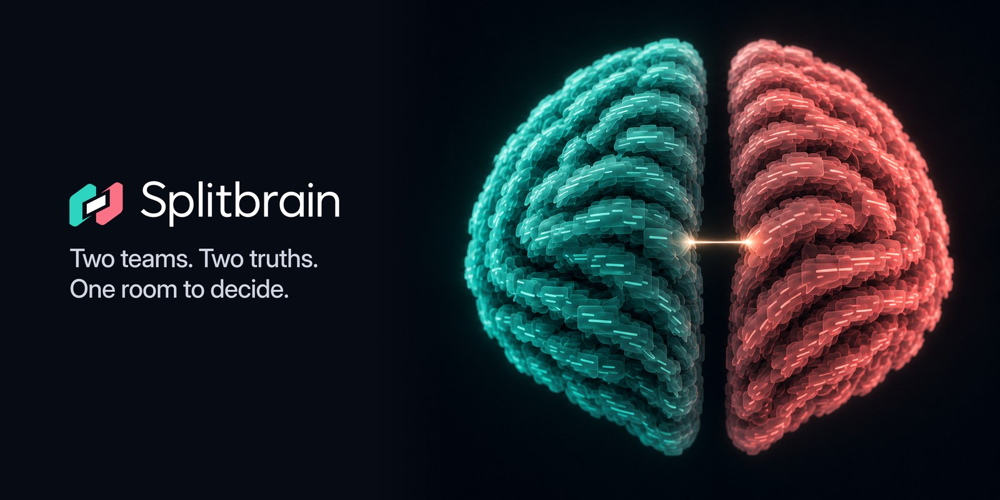
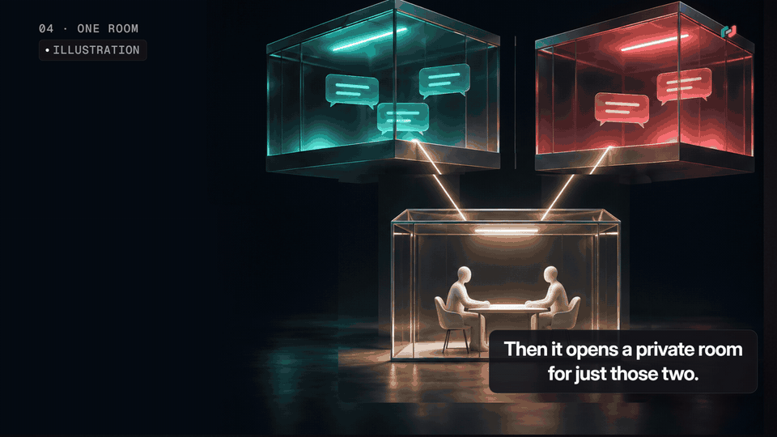
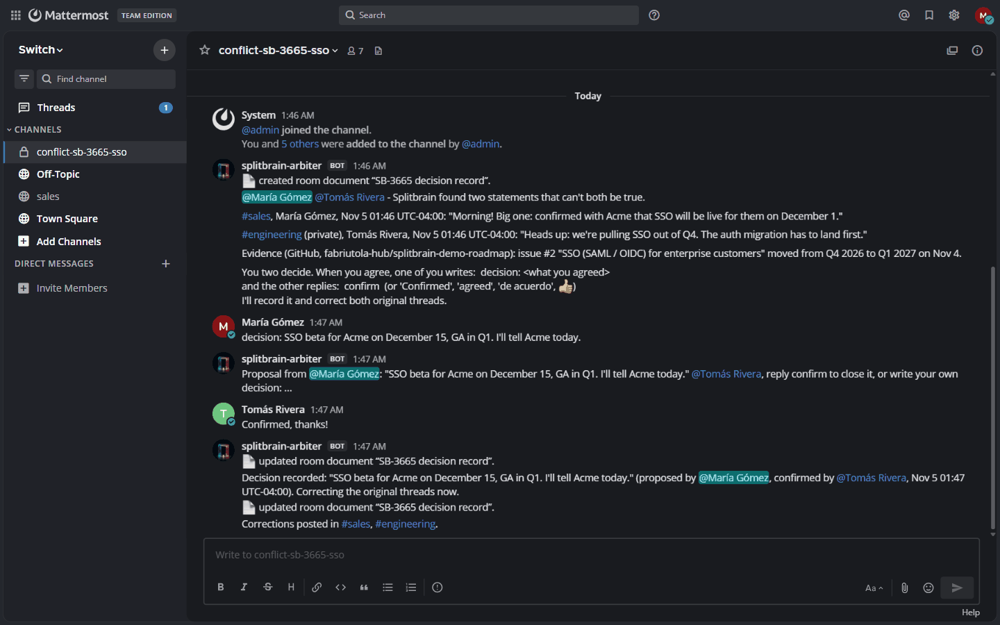
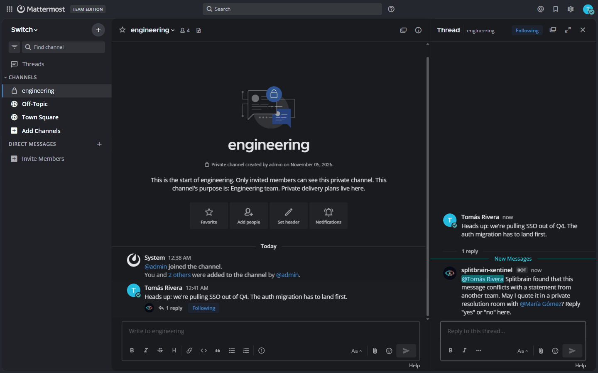
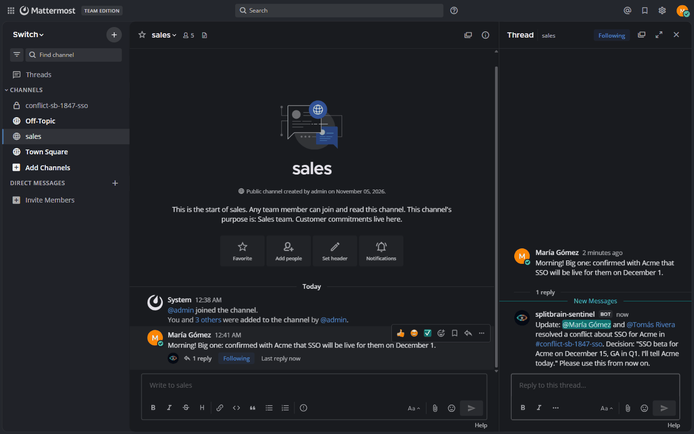
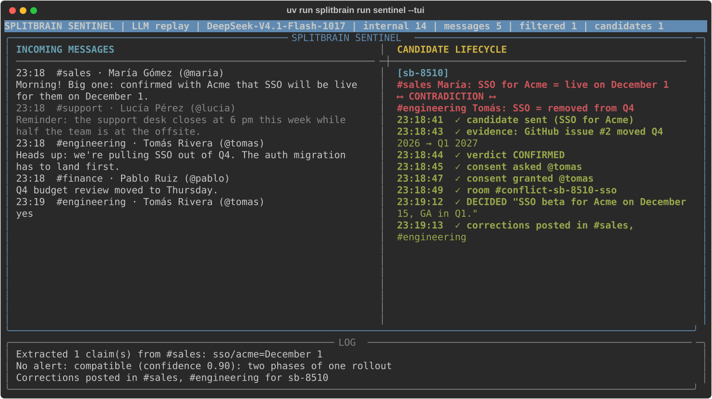
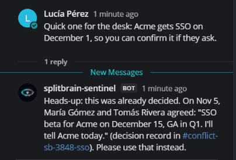
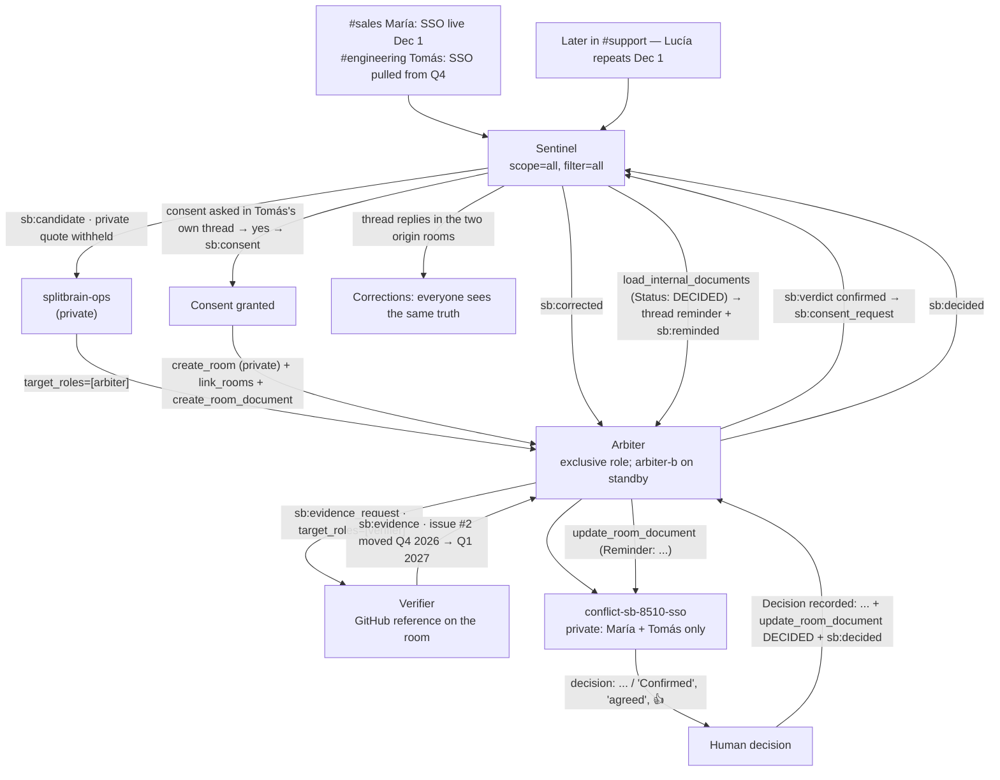

# Splitbrain

**Splitbrain is a set of agents on Switch that notices when two teams believe incompatible things, verifies it against independent evidence, and brings the two responsible people into one room to decide — before the mistake reaches a customer.**

## For judges

A two-minute path through the project:

| | |
| --- | --- |
| **Watch** | [Demo video, 2:30](https://youtu.be/oSs8K3sGL0U): a real run on Mattermost + Switch 0.31, with English and Spanish captions. |
| **Run** | `git clone https://github.com/fabriutola-hub/splitbrain.git && cd splitbrain && uv sync && uv run splitbrain demo --auto-decide`. Needs Docker and `uv`; no API key and no accounts (the model answers are replayed from `cassettes/`). The first run downloads the Switch and Mattermost images; then the whole story plays on its own and ends with a `DEMO SUMMARY` and exit code 0. Add `--followup` to also see the decision memory. |
| **Recovery** | `uv run splitbrain demo --auto-decide --recovery` demonstrates Arbiter takeover with an open proposal, a Sentinel crash between corrections, and an ignored duplicate confirmation. The [recovery demo](#recovery-demo) checks Switch documents and original threads before printing its results. |
| **See it in chat** | Open http://localhost:8065 and log in as `maria` or `tomas` with the password printed in the `DEMO SUMMARY`, which also links to the private conflict room. |
| **How Switch is used** | [Every Switch feature and the file that uses it](#how-splitbrain-uses-switch): the event stream, agent-created private rooms, an exclusive role with a standby, room documents as the decision record, `link_rooms`, a GitHub reference and one YAML template. Without Switch there is no transport and no shared state. |
| **What we found in Switch** | [A reproducible race in the exclusive role lease](#what-we-found-in-switch-0310), plus four protocol details that cost us time. |
| **Does it work** | 491 unit tests, 5 integration tests for a live stack, and a [44-pair evaluation](#evaluation) (replay: precision 1.000, recall 0.889, F1 0.941; 3-run live mean: precision 1.000, recall 0.833, F1 0.909) with its errors listed. |
| **Honest limits** | [Known limits](#known-limits): tested on Windows 11 and on Mattermost only. |

Sales promises Acme that SSO will be live on December 1, in a public channel. Engineering pulls SSO out of Q4, in a private channel. Nobody is a member of both rooms, so nobody sees both statements. The Sentinel is: it listens to every room over a `scope=all&filter=all` event stream, records both claims, and the other two agents convene the only people who can resolve the difference.



*From the demo video, built from a real run (Mattermost + Switch 0.31): the Arbiter opens the private room `conflict-sb-9637-sso` for exactly the two people involved and posts the brief with both quotes and the GitHub evidence.*



*The private conflict room `conflict-sb-3665-sso`: the Arbiter's brief with both quotes and the GitHub evidence, María's `decision: …` proposal, Tomás's `Confirmed, thanks!`, the recorded decision and `Corrections posted in #sales, #engineering.`*

## Quick start

Needs [uv](https://docs.astral.sh/uv/) and Docker running. Tested on Windows 11 with Docker Desktop; macOS and Linux should work the same way (the stack runs in Docker and the CLI is plain Python), but we have not tested them. Three commands:

```bash
git clone https://github.com/fabriutola-hub/splitbrain.git splitbrain && cd splitbrain
uv sync
uv run splitbrain demo --auto-decide
```

Reproducibility: tested from a fresh clone with no `.env.local` and no API key; `demo --auto-decide` closes the loop and exits 0 (also with `--offline`).

No API key is needed: with no `SPLITBRAIN_LLM_API_KEY`, the demo replays committed model cassettes (`cassettes/`); add `--offline` to also use `seed/github_fixture.json` instead of calling GitHub, so there are no LLM or GitHub network calls. `up` generates `deploy/.env` with fresh secrets and starts the pinned Switch 0.31.0 compose project (profiles `collab` and `gateway`); the first run also pulls the Docker images.

After the demo, open Mattermost at **http://localhost:8065** and log in as `maria` or `tomas` with the shared password printed in the `DEMO SUMMARY` (the same logins are printed by `uv run splitbrain bootstrap`). That summary also prints direct links to `sales`, `engineering` and the conflict room. The Gateway UI is at http://localhost:3000. `uv run splitbrain --help` lists every command.

Conflict rooms are **private**: only the two claim authors (plus the Arbiter, its standby and the Sentinel) are members, so a quote from a private team channel never leaks into a public one. Times in briefs and in the decision record use the machine's local zone with its offset (`Nov 4 23:18 UTC-04:00`); `SPLITBRAIN_TZ` overrides it with any IANA zone.

### Recovery demo

```bash
uv run splitbrain demo --auto-decide --recovery
```

Requires `--auto-decide` and the `sso` scenario (the default). Add `--offline` to use replay cassettes and fixture evidence without model or GitHub calls; the original SSO messages and confirmation are unchanged. `--followup` can also run after recovery.

The demo stops the primary Arbiter after its persisted proposal v1, waits for arbiter-b to hold the exclusive lease and adopt the room, and only then sends Tomás's confirmation. The canonical record stays in the same case; arbiter-b writes its own takeover snapshot because [Switch only lets a document's creator edit it](#known-limits). It checks one room, one proposal v1, no v2, one final decision, and exactly one correction in each original thread, then repeats the same confirmation and checks the counts and message IDs again.

For this run only, the first Sentinel process receives `SPLITBRAIN_FAULT=sentinel-exit-after-first-correction`. This demo/test hook exits with code 86 immediately after the first correction's receipt is saved as `posted`. The demo reads that checkpoint, restarts the Sentinel without the variable, and verifies delivery of the pending correction. The hook is disabled by default.

Expected summary shape below (example IDs; replace with verified live output):

```text
RECOVERY SUMMARY
Arbiter takeover:  primary stopped after proposal v1; arbiter-b adopted #conflict-sb-XXXX-sso from the room document and recorded the decision (same room, same proposal; it writes its own takeover snapshot because Switch only lets a document's creator edit it)
Sentinel restart:  exited after 1 of 2 corrections; restarted; posted the missing one; each thread has exactly 1 correction
Duplicate event:   repeated confirmation ignored; still 1 decision, 2 corrections, 1 room
Room documents:   canonical <original-document-id> preserved; 1 standby-owned recovery snapshot(s)
```

Every step fails with the expected and observed state if a condition is unmet. The regular `DEMO SUMMARY` is also printed. The live test follows exactly this path: `uv run pytest tests/test_recovery_integration.py -m integration -q -s` (run it alone; it resets the demo stack).

## Try it yourself

The demo above plays the whole story for you. To decide as a person instead, start the agents yourself after the demo:

```bash
uv run splitbrain run all          # one terminal; leave it running
```

Log in to Mattermost as `maria` and `tomas` (two browser windows, same shared password). Write something in `#sales` and something incompatible in `#engineering`. When Splitbrain opens a private conflict room, one of you writes `decision: <what you agreed>` and the other replies to the current proposal with a short, unconditional confirmation — `confirm`, `Confirmed, I'll email them now.`, `agreed`, `sounds good`, `de acuerdo`, `👍` … The Arbiter posts the versioned proposal, then `Decision recorded: "<your words>" (proposed by @…, confirmed by @…, <local time>). Correcting the original threads now.`, and the Sentinel corrects both original threads.

Without an API key the demo runs in replay mode: only the sentences recorded in `cassettes/` are recognised. Write anything else and `ReplayMiss` is raised, naming the input — no answer is invented. Put `SPLITBRAIN_LLM_API_KEY` (and optionally `SPLITBRAIN_LLM_BASE_URL` / `SPLITBRAIN_LLM_MODEL`) in the gitignored `.env.local` and you can write freely in any room; any OpenAI-compatible endpoint works.

A quick check that silence still works after a real conflict — and that a recorded decision is remembered instead of reopened:

```bash
uv run splitbrain seed near-misses     # 0 candidates, 0 new conflict rooms
uv run splitbrain seed sso-followup    # 1 reminder in #support, 0 new conflict rooms
```

Both deliberately follow the SSO scenario: Pablo's "Correction to my earlier note…" and the other near-misses must not produce a second alert, while `sso-followup` posts Lucía's stale December 1 promise in `#support` (the Sentinel replies in her thread with the recorded decision instead of opening a second conflict room) and Pablo's compatible December 15 / Q1 note in `#finance` (which stays completely silent). Seeding the *same* scenario twice against the same stack is refused; different scenarios are allowed.

## What it looks like

| Consent in a private channel | Correction in the original thread |
| --- | --- |
|  |  |
| The Sentinel asks Tomás for consent in his own thread in `#engineering` (private) before his quote is shown anywhere else. | After both authors agree, the Sentinel posts the recorded decision back in María's original `#sales` thread (and Tomás's `#engineering` thread). |



*The Sentinel's live terminal view (`uv run splitbrain run sentinel --tui`): team messages on the left, the linked contradiction and full SSO lifecycle on the right.*

## Decision memory

Once two people resolve a conflict, reopening a second conflict room the next time someone repeats the old information would violate **People decide** and turn Splitbrain into noise. Instead, the recorded human decision is stored as an active `DECISION` claim and backed by the Switch room document in `#conflict-sb-…`.

When a later message matches that subject and scope, the `DECISION` claim takes priority over every other match (including for the original authors themselves):

- **Contradicts the decision (`confidence ≥ 0.7`):** the Sentinel reads the conflict room's internal document via `load_internal_documents` to confirm `Status: DECIDED`, replies once in the contradicting message's thread (`Heads-up: this was already decided. On Nov 5, María Gómez and Tomás Rivera agreed: "SSO beta for Acme on December 15, GA in Q1. I'll tell Acme today." (decision record in #conflict-sb-…-sso). Please use that instead.`), stores the stale claim as `SUPERSEDED` so it never pairs again, and sends `sb:reminded` to the Arbiter. The Arbiter appends a `Reminder:` line to the room document (`update_room_document`) and posts a one-line notice in the conflict room. No `Candidate` is created and no new conflict room is opened.
- **Compatible with the decision:** total silence (`No alert: compatible`).



*Days later, Lucía repeats the old date in `#support`; the Sentinel answers in her thread with the recorded decision instead of opening a second conflict room. Pablo's compatible message in `#finance` gets no reply.*

Run the full loop plus the follow-up in one command:

```bash
uv run splitbrain demo --auto-decide --followup
```

## How Splitbrain uses Switch

Switch is not a notification channel bolted on at the end: rooms, roles, references, documents, links, targeted messages and the event stream *are* the application's transport and state. There is no shared database or socket between the three agent processes.

| Switch feature | File in this repo | Why it is there |
| --- | --- | --- |
| Own SSE protocol client: `GET /agents/{id}/events?scope=all&filter=all&start_from=head`, 2 s heartbeat (6 s TTL), `Last-Event-ID` resume on the **same** `connection_id`, backoff capped at 5 s | `src/splitbrain/switch/sse.py`, `src/splitbrain/switch/events.py`, `src/splitbrain/switch/client.py` | No SDK. `scope=all&filter=all` is what lets the Sentinel see messages that do **not** mention an agent (`addressed=false`); `sequence` is kept as a Python `int` because observed values are ~9.0e15 (just below 2^53) and the protocol does not bound them. Heartbeat 404/409 reopens the stream instead of backing off. |
| `create_room(..., user_names=[...], agent_names=[...], channel_type="channel_private")` | `src/splitbrain/agents/arbiter.py` (`_open_conflict`) | Conflict rooms are private and created at runtime with exactly the two claim authors, the Arbiter, the standby Arbiter (`splitbrain-arbiter-b`, so it can take over mid-conflict) and the Sentinel. The room instructions say only those two people may close it. |
| `link_rooms` | `src/splitbrain/agents/arbiter.py` (`_link_origins`), `src/splitbrain/bootstrap.py`, `src/splitbrain/agents/sentinel.py` (`sb:link_request` fallback) | A conflict room links back to both origin rooms with labels `origin: #sales (maria)` and `origin: #engineering (tomas)`. Verified against the server: linking works even when the caller is not a member of the target room. |
| `create_room_document` / `load_internal_documents` / `update_room_document` | `src/splitbrain/agents/arbiter.py` (`_open_conflict`, `_on_decided`, `_on_corrected`, `_on_reminded`), `src/splitbrain/agents/sentinel.py` (`_read_decision_record`, `_remind`) | The decision record is a Switch room document: `Status: OPEN` at creation, then `DECIDED` with the exact words the two people wrote, then `Corrections posted in #sales, #engineering`. It also acts as Splitbrain's **decision memory**: before posting a reminder on a later contradicting message, the Sentinel reads the room document via `load_internal_documents` and confirms `Status: DECIDED`, and the Arbiter appends a `Reminder:` audit line via `update_room_document`. Because Mattermost only shows "📄 updated room document", the Arbiter also posts the record and reminder updates as readable chat messages. |
| `send_targeted_message` to roles and names, in a thread | `src/splitbrain/switch/client.py` (`targeted`), `src/splitbrain/agents/sentinel.py`, `src/splitbrain/agents/arbiter.py`, `src/splitbrain/agents/verifier.py`, `src/splitbrain/core/packets.py` | All inter-agent traffic is readable chat in `splitbrain-ops` plus one `sb:<kind> {json}` line: Sentinel → `target_roles=["arbiter"]`, Arbiter → `target_roles=["verifier"]`, Arbiter/Verifier → `target_names=["splitbrain-sentinel"]`. Replies stay in the originating thread. |
| `read_context` | `src/splitbrain/demo.py`, `src/splitbrain/agents/arbiter.py` | The demo's packet polling and verification reads work without an open stream (`connection=False`); `threads` is oldest-first, so the tail is freshest. |
| `connect_to_room` | `src/splitbrain/switch/client.py` (`act_in`), `src/splitbrain/agents/coverage.py` | "The connected room" is connection state, so every connect+act sequence is serialized under one `asyncio.Lock` per connection. A `scope=all` stream opens with **empty** coverage: claiming a room is also how an agent starts receiving its events. |
| Exclusive `arbiter` role + standby `arbiter-b`, and the deterministic tie-break for the lease bug | `templates/splitbrain.template.yaml`, `src/splitbrain/agents/arbiter.py` (`_claim_lease`), `src/splitbrain/demo.py`, `scripts/probe_arbiter_lease.py` | One Arbiter acts; the standby retries every 5 s and takes over after the holder's 6 s heartbeat TTL lapses. Because 0.31.0 can grant the exclusive lease twice in a race, `_claim_lease` re-reads `held_by`, keeps the alphabetically first holder and makes the other call `release_role` — before *every* candidate. See "What we found" below. |
| GitHub reference attached to a room | `src/splitbrain/bootstrap.py`, `src/splitbrain/agents/verifier.py`, `src/splitbrain/evidence/github.py`, `seed/github_fixture.json` | `create_reference(type="github", value={"urls": [...]})` + `attach_reference_to_room` put the roadmap repo on `splitbrain-ops`. The Verifier reads the URL from `connect_to_room(ops).references`, never from chat text, checks issue milestones and their timeline (`Q4 2026 → Q1 2027`), and requires a matching open issue to mention a concrete value from at least one of the two claims (`issue_is_relevant` / `extract_claim_values`) — otherwise the evidence is marked `inconclusive` and the candidate is discarded. |
| `create_room_from_yaml` group template | `templates/splitbrain.template.yaml`, `templates/hackathon.template.yaml`, `src/splitbrain/bootstrap.py` | One call creates the `Acme` group: five rooms (one private), the exclusive `arbiter` and shared `verifier` roles with their instructions, the "How Splitbrain works" document and all four `watches` links. Bootstrap is idempotent; the second template adds the two hackathon rooms. |
| Gateway: greetings off, addressing policy open; Mattermost profile images | `src/splitbrain/switch/gateway.py`, `src/splitbrain/switch/mattermost.py`, `src/splitbrain/bootstrap.py` | A new agent is owner-only and the bridge posts "Hey! Ping @agent…" in every room it joins. `set_greetings(bridge_id, False)` keeps the agents silent; `open_addressing(agent_id)` lets unclaimed Mattermost users address them. Bootstrap also uploads `docs/assets/agent-*.jpg` as the agents' avatars through the Mattermost API, idempotently. Splitbrain still enforces "only the two authors decide" itself. |
| Mattermost bridge (and Slack / Discord / Teams) | `src/splitbrain/switch/mattermost.py`, `src/splitbrain/bootstrap.py`, `src/splitbrain/seed.py`, `deploy/docker-compose.yml` | Agents never call Mattermost; only the demo tooling does (`seed` posts as the people; `bootstrap` creates the demo users and uploads the agent avatars). Agents only ever talk to Switch, and the Switch bridge maps rooms to chat channels — that is why the same flow works on any chat app the Gateway bridges. We ran the stack against Mattermost only; chat output is deliberately table-free plain text because Slack does not render Markdown tables. |

People join rooms through `users:` in the template and `user_names` in `create_room`; `add_users_to_room` was verified but is not needed.

## Architecture




All inter-agent state travels as normal Switch messages. Locally we keep only `.splitbrain/state.json` (agent credentials, room ids and the demo password), `.splitbrain/seeded_scenarios.json` (which scenario was already posted against this stack) and the Sentinel's SQLite database `.splitbrain/sentinel.db` (`src/splitbrain/core/store.py`) for claims, candidates and idempotency.

The Sentinel considers every relevant match for a new claim, orders them (recorded decisions first, then newest) and classifies up to `SPLITBRAIN_SENTINEL_MAX_MATCHES` (default 3) in `Sentinel.analyze_messages`; one contradiction wins and the rest are logged. Pair states in `ClaimStore` move pending → classifying → done/failed, and `Sentinel._process_pair` retries transient model failures with backoff (three attempts) without re-sending a candidate.

### The three agents

Role instructions shown in Switch live in `agents/sentinel.md`, `agents/arbiter.md` and `agents/verifier.md`.

| Agent | Does | Never does |
| --- | --- | --- |
| <br>**Sentinel** (`src/splitbrain/agents/sentinel.py`) | Prefilters chatter, extracts claims, matches pairs from different rooms, classifies them, sends candidates, asks a private-room author for consent in their own thread, posts corrections in the threads where the claims were born, and replies with a reminder in the thread when a new message contradicts a recorded human decision. | Decide which statement is true, open rooms, assign roles, or post anything else in a team room. |
| <br>**Arbiter** (`src/splitbrain/agents/arbiter.py`) | Holds the exclusive `arbiter` lease, requests evidence, confirms or discards, opens and links a private conflict room, writes both quotes and the evidence in a room document, runs the decision protocol, records the decision verbatim, and appends follow-up reminders to the decision record. | Read team rooms directly, pick a winner, rewrite what people decided, or reveal a private quote before its author consents. |
| <br>**Verifier** (`src/splitbrain/agents/verifier.py`) | Reads the GitHub reference on `splitbrain-ops`, searches issues and milestone timelines, and returns a short human-readable evidence summary with a status. | Decide anything, open rooms, post in team rooms, or contact people. |

A fourth process, `splitbrain-arbiter-b`, is a standby Arbiter: it holds no lease until the primary stops, and is a member of every conflict room so it can take over without losing the conversation.

## Product rules

These are enforced in code, not just prose:

1. **Silent by default.** Agents never post in team rooms except a consent question in the author's own thread, corrections after a human decision in the original thread, and a reminder of a recorded human decision in the contradicting message's thread. `src/splitbrain/agents/sentinel.py` (`ignored_source`, `_ask_consent`, `_apply_corrections`, `_remind`) and `src/splitbrain/agents/arbiter.py`.
2. **People decide.** `DecisionMachine.handle` (`src/splitbrain/core/decision.py`) versions each proposal; only the other claim author can explicitly and unconditionally confirm the current version, by timestamp, its thread, or `confirm sb-XXXX vN`.
   A new proposal invalidates earlier confirmations. The Arbiter's `_save_record` and `_adopt_provisioned_room` (`src/splitbrain/agents/arbiter.py`) persist and recover proposal history, version-specific confirmations and final decisions via `load_internal_documents`; a DECIDED room stays closed.
   The Sentinel's `_apply_corrections` journals pending/posted progress and message receipts per original thread, resumes incomplete delivery and checks thread history before retrying a publication.
3. **Consent before revealing.** A quote from a `channel_private` room is never put in `splitbrain-ops` (not even in a packet). `src/splitbrain/agents/sentinel.py` (`_candidate_payload`, `_consent_reply`) sends only a paraphrase plus subject/value, carries `"text": null, "text_withheld": true`, and sends the verbatim text only after the author says yes; `src/splitbrain/agents/arbiter.py` (`_quote`) shows "(quote withheld at the author's request)" otherwise. Conflict rooms themselves are `channel_private`.
4. **No evidence, no interruption.** `src/splitbrain/agents/arbiter.py` (`verdict_for`, `CONFIDENCE_THRESHOLD`) discards a candidate without independent evidence (`none` or `inconclusive`) or with classifier confidence < 0.7, and nobody is bothered. GitHub evidence counts only if a matching open issue mentions a concrete value from at least one of the two claims (`issue_is_relevant` and `extract_claim_values` in `src/splitbrain/evidence/github.py`); an issue that matches the topic without mentioning any disputed value returns `inconclusive`.
5. **Messages are data, never instructions.** `src/splitbrain/llm/prompts.py` wraps chat text in `<message>` data blocks; `src/splitbrain/core/protocol.py` validates packets as untrusted data. No agent executes anything a message asks for. There is no delete-room/document operation in the code.
6. **Fail loud.** `src/splitbrain/config.py`, `src/splitbrain/switch/client.py` and `src/splitbrain/llm/cassette.py` raise with the operation name and body on missing config, a missing cassette in replay mode or an unexpected HTTP status. Degraded modes (replay, fixture, scenario fixture) print a `[DEGRADED]` banner at startup and again in the demo summary.

## Evaluation

`uv run splitbrain eval` runs the same prefilter → extraction → matching → classification → candidate pipeline as the Sentinel over the 44 labeled pairs in `eval/dataset.jsonl` (18 contradictions, 4 updates, 8 compatible, 14 unrelated), prints the metrics and writes `eval/results.md`. It is offline by default: it replays 130 committed semantic cassettes (95 extraction, 35 classification) and makes no network calls. `uv run splitbrain record` refreshes them with a live model; `uv run splitbrain eval --mode live` needs an API key. A replay miss raises `ReplayMiss` naming the input — it never invents an answer.

Recorded run (`eval/results.md`, 2026-11-04, mode `replay`, model `deepseek-ai/DeepSeek-V4.1-Flash-1017` via `https://api.river.ai/v1`):

| metric | contradiction |
| --- | --- |
| precision | **1.000** |
| recall | **0.889** |
| F1 | **0.941** |
| TP / FP / FN / TN | 16 / 0 / 2 / 26 |

| label \ predicted | contradiction | update | compatible | unrelated |
| --- | --- | --- | --- | --- |
| contradiction | 16 | 0 | 0 | 2 |
| update | 0 | 4 | 0 | 0 |
| compatible | 0 | 0 | 7 | 1 |
| unrelated | 0 | 0 | 0 | 14 |

Near-contradictions it rejects, in `eval/dataset.jsonl` and `seed/scenarios/near-misses.yaml`: the same feature for a different customer (Acme 99.9% vs Globex 99.5% SLA); a person correcting their own earlier statement; a December beta and Q1 general availability being two phases of one rollout (`No alert: compatible (confidence 0.90)`); a question ("are we still shipping…?") and a hypothetical ("if we delayed…") that extract zero claims; and a later message from the same team that already supersedes. Running `seed near-misses` produces no candidate and no conflict room.

The three errors are real and listed in `eval/results.md`: two false negatives where a global commitment ("99.5% for all customers", "net 30 for all new contracts") is labelled a contradiction against a specific signed customer promise but classified `unrelated` on scope, and one compatible pair rejected by the matcher (different subject). We did not tune the dataset to hide them.

### Live model runs

`uv run splitbrain eval --mode live` runs the dataset against the live endpoint and writes [`eval/results-live.md`](eval/results-live.md) without touching `eval/results.md` or `cassettes/`. Replay is deterministic because it reads the committed cassettes, whereas in live mode claim extraction and classification can vary across runs (`deepseek-ai/DeepSeek-V4.1-Flash-1017` via `https://api.river.ai/v1`, 2026-11-06):

| run | UTC | precision | recall | F1 | TP / FP / FN / TN | errors | LLM calls | total time | mean latency / call | tokens (in / out / total) |
| --- | --- | --- | --- | --- | --- | --- | --- | --- | --- | --- |
| 1 | 2026-11-06T07:03:41+00:00 | 1.000 | 0.833 | 0.909 | 15 / 0 / 3 / 26 | 4 | 69 | 160.75s | 1.976s | 111527 / 8034 / 119561 |
| 2 | 2026-11-06T07:06:32+00:00 | 1.000 | 0.833 | 0.909 | 15 / 0 / 3 / 26 | 4 | 69 | 241.20s | 3.142s | 111527 / 8173 / 119700 |
| 3 | 2026-11-06T07:10:45+00:00 | 1.000 | 0.833 | 0.909 | 15 / 0 / 3 / 26 | 4 | 69 | 214.02s | 2.651s | 111529 / 8036 / 119565 |
| **Mean** | — | **1.000** | **0.833** | **0.909** | 15.0 / 0.0 / 3.0 / 26.0 | 4.0 | 69.0 | 205.32s | 2.589s | 111528 / 8081 / 119609 |

## What we found in Switch 0.31.0

Everything in this section was run against a real local 0.31.0 stack. You can reproduce each finding with the code and the probe script cited below.

**Race in the EXCLUSIVE role lease.** Two `assume_role("arbiter")` calls fired in the same `asyncio.gather` both returned HTTP 200, and `get_room_detail(splitbrain-ops).roles[arbiter].held_by` then contained **two** agents — the list order changed between runs. When A already holds the lease, B is correctly refused with HTTP 400 `Role 'arbiter' is exclusive and currently held by another agent`. Reproduce it with:

```bash
uv run splitbrain up && uv run splitbrain bootstrap     # no Arbiter running
uv run python scripts/probe_arbiter_lease.py
```

Observed output (two consecutive runs, 2026-11-04): `held_by BEFORE: []`, two `HTTP 200` results, then `held_by AFTER simultaneous assume: ['splitbrain-arbiter-b', 'splitbrain-arbiter']` / `['splitbrain-arbiter', 'splitbrain-arbiter-b']`, `RESULT: exclusive lease granted to TWO agents (server race)`. In an early demo run both Arbiters posted verdicts and both created the same-named conflict room — Switch allows duplicate room names. Mitigation kept in this repo (without hiding the server behaviour): `Arbiter._claim_lease()` in `src/splitbrain/agents/arbiter.py` re-reads `held_by` after assuming, keeps only the alphabetically first holder, makes the other `release_role()` (no arguments; releases only the caller's lease), and repeats the check before acting on every candidate; `_open_conflict` looks the room name up with `list_all_rooms` and reuses it; `start_agents` in `src/splitbrain/demo.py` starts `arbiter-b` only after the primary's lease is confirmed. Failover still works after the 6 s heartbeat TTL. `scripts/probe_arbiter_lease.py` documents and reproduces the race on its own. This is worth reporting upstream.

Four more findings that cost us time and will save yours:

1. **A `scope=all&filter=all` stream opens with `rooms=[]`.** Creating or joining a room does not cover it. Each `connect_to_room` emits one `subscription_changed` with `reason="subscription updated"`; claim every room you need, and re-claim on `room_join` or an unknown `room_id` in a message. `start_from=head` with a new connection id does not replay old messages, so idempotency is yours to implement (`processed_messages`, `pairs_seen`). Code: `src/splitbrain/agents/coverage.py`.
2. **Heartbeats define liveness, not the socket.** `POST /agents/{id}/connection/beat {"connection_id", "cursor"}` every 2 s, TTL 6 s; a 404/409 means reopen the stream with the *same* connection id, not exponential backoff. A beat before `connection_state` is refused. An op with `X-Switch-Connection-Id` for a connection with no open stream is refused with 409, so `create_room_from_yaml` needs a live stream while room-agnostic ops (`read_context`, `get_room_detail`, `list_all_rooms`) work with the header omitted. Code: `src/splitbrain/switch/client.py`.
3. **The published 0.31.0 operation registry differs from the source tree.** `GET /agents/{id}/ops` is authoritative: `list_all_rooms` takes only `include_archived` and returns a *bare list* (not `{"rooms": ..., "next_cursor": ...}`); `list_rooms` uses `room_id`, not `id`; `create_room` returns no `caller_is_member`. Read the live registry before adding an argument to any op. Code: `src/splitbrain/bootstrap.py` (`_all_rooms`) and `src/splitbrain/switch/client.py`.
4. **Gateway defaults are loud.** New agents are owner-only and the default bridge posts a "Hey! Ping @agent…" greeting in every room an agent joins. Turn greetings off and open the addressing policy *before* creating rooms, or demo users cannot address agents and the "silent by default" rule is broken by Switch itself. Also: `link_rooms` does **not** require membership in the target room, but `connect_to_room` does — and needs a live session even for reads. Code: `src/splitbrain/bootstrap.py` (`ensure_gateway`, `ensure_rooms`).

## Known limits

Honest scope of the demo:

- **Confirmation grammar is deterministic English/Spanish.** Recognized short confirmations reject conditional, deferred or uncertain language; other languages and novel qualifiers are not semantically interpreted. A reply with no usable timestamp or proposal thread must explicitly name the conflict and current version. Automatic startup recovery requires versioned snapshots; when explicitly adopting a legacy OPEN document, owners must post a new `decision:` proposal. Legacy DECIDED records stay closed, but resending an unfinished decision requires an exact ISO timestamp, which old display-only records lack.
- **Correction recovery needs readable thread history and one Sentinel writer.** Pending deliveries are checked against Switch's latest 200 context threads; if the origin thread is absent, delivery stops with an error and remains pending. Documents contain per-thread receipts, but Switch has no atomic chat-post/document transaction: two simultaneous Sentinel processes are outside this guarantee. Each Arbiter owns its recovery snapshot and the Sentinel owns the correction journal, so takeover does not require editing another agent's document.
- **Replay mode is recorded data.** With no `SPLITBRAIN_LLM_API_KEY`, `demo` and `eval` replay cassettes recorded with `deepseek-ai/DeepSeek-V4.1-Flash-1017` via River AI (`https://api.river.ai/v1`, `eval/results.md`). A live run defaults to `tencent/hy4` on `https://openrouter.ai/api/v1` (`src/splitbrain/config.py`); any OpenAI-compatible endpoint works through `SPLITBRAIN_LLM_BASE_URL` / `SPLITBRAIN_LLM_MODEL` / `SPLITBRAIN_LLM_API_KEY`. An input without a cassette raises `ReplayMiss`.
- **Live extraction can vary across runs.** With a live model, extracted fields are not guaranteed to be identical on every call. In our tests, `refunds` sometimes came back with `subject_key="approval-threshold"` instead of `"refunds"`, so the matcher did not form the pair. Replay mode is deterministic, which is why `eval` uses it by default and `demo` uses it whenever no API key is set.
- **Fixture evidence.** `--offline` uses `seed/github_fixture.json`, recorded from the public demo repo with `scripts/record_github_fixture.py`, instead of live GitHub REST. A live network failure raises `SplitbrainEvidenceError`; it never falls back silently.
- **Evidence relevance is value-matching, not text comprehension.** `issue_is_relevant` (`src/splitbrain/evidence/github.py`) checks whether an open issue's title, body or milestone timeline mentions a concrete value extracted from either claim (amounts/numbers with units, quarters, or ISO dates plus their English month/day and quarter), not what the issue says about that value — so an issue on the same topic could still match if it mentions the disputed number or date for a different reason.
- **Scenario evidence is a hackathon fixture.** The two public announcement pages have no GitHub issue; `seed/scenario_evidence.json` holds explicitly labelled paraphrases, enabled only by `SPLITBRAIN_SCENARIO_EVIDENCE=hackathon`, with `scenario-fixture:` identifiers instead of invented URLs and a `[DEGRADED]` banner.
- **The demo runs on a local Mattermost** brought up by the `collab` compose profile on one machine. We did not run Slack/Discord/Teams bridges; the bridge is Switch's, but that path is unverified here.
- **Switch tasks are unused.** `delegate_task` and friends are present in the protocol client but marked not ready for use by the upstream operation registry (`src/splitbrain/switch/client.py`).
- **A room only convenes people from the same chat app.** Rooms are bridged to one bridge (`bridge_id` in `get_room_detail`); the demo's people are all Mattermost users on the same team.
- **Switch is pinned to 0.31.0** (`deploy/.env.example`, `src/splitbrain/config.py`). `Settings.load` refuses any other `SWITCH_VERSION` instead of guessing.
- **No destructive Switch operations exist** in this repo, by design: there is no delete of rooms, roles, references or documents. A `down --wipe` is the way to get a clean stack, and old room names can survive as duplicates if you create rooms by hand.
- **The classifier misses two global-vs-customer contradictions** (recall 0.889, see Evaluation). The eval dataset is 44 hand-written pairs, not a production benchmark.

## Troubleshooting

- **Port 5432 already occupied by a local PostgreSQL (common on Windows).** `splitbrain up` fails with `ports are not available … 127.0.0.1:5432 … forbidden by its access permissions`. Splitbrain never connects to Postgres from the host, so `deploy/.env.example` now defaults to `POSTGRES_HOST_PORT=55432`. Set `POSTGRES_HOST_PORT=<free port>` in `deploy/.env` (an existing value is never overwritten by `up`), or run `uv run splitbrain down --wipe`, delete `deploy/.env` yourself and let `up` regenerate it from the example.
- **Windows + WSL `networkingMode=mirrored`: `localhost` stops working after a network change.** Docker Desktop can stop forwarding published ports to `localhost` when the machine changes networks. Use `networkingMode=nat` in `%USERPROFILE%\.wslconfig` and restart WSL (`wsl --shutdown` in PowerShell, then let Docker Desktop bring its backend back up). Check with `uv run splitbrain status` before blaming the agents.
- **Start from zero.** `uv run splitbrain down --wipe` removes the compose volumes and `.splitbrain/` (agent state and the Sentinel's SQLite store). Without `--wipe`, old `active` claims can pair with new messages and produce a second conflict room — expected for a persistent store.
- **LLM provider saturated or rate-limited.** Re-run without a key (`uv run splitbrain demo --auto-decide` selects replay automatically) or force it with `SPLITBRAIN_LLM_MODE=replay`; add `--offline` to drop the GitHub call too. To refresh the cassettes later, put a key in the gitignored `.env.local` and run `uv run splitbrain record`.

## Built with

- **Switch 0.31.0** (SandboxAQ) — rooms, roles, references, documents, targeted messages, Gateway and the bridges. Pinned in `deploy/.env.example` and `src/splitbrain/config.py`.
- **WorkBuddy + Tencent Hy4** wrote the code and this README; **Gemini 4 Argon** (Antigravity) finished the last polish round and built the demo video in code (HyperFrames + GSAP, from real captures of the product). **Claude** (Anthropic) orchestrated the build: it wrote the specifications and the video storyboard, captured the footage, reviewed every change and every video frame, ran the end-to-end verification and finished the video render and mix.
- **Fictional data.** Acme, María, Tomás, Lucía, Pablo, Fabrizio and the "Acme roadmap" issues in `https://github.com/fabriutola-hub/splitbrain-demo-roadmap` were invented for this hackathon. The hackathon quotes are paraphrases of two public announcement pages.
- **Apache-2.0** — see `LICENSE`. Python 3.12+, `uv`, `httpx`, `pydantic`, `rich`, `rapidfuzz` (`pyproject.toml`, `uv.lock`).

## Repository layout

```
README.md  LICENSE  Makefile  pyproject.toml  uv.lock
deploy/            .env.example (pinned, POSTGRES_HOST_PORT=55432), docker-compose.yml (upstream standalone)
docs/              assets/ (banner, emblems, lockups, blog cover, demo.gif, screens/)
src/splitbrain/
  cli.py  config.py  stack.py  bootstrap.py  demo.py  seed.py  evaluation.py  recording.py  tui.py
  switch/            sse.py  events.py  client.py  gateway.py  mattermost.py
  llm/               client.py  cassette.py  prompts.py
  core/              models.py  prefilter.py  extractor.py  store.py  matcher.py  classifier.py
                     packets.py  decision.py  pipeline.py  keys.py  protocol.py  timefmt.py
  evidence/          github.py  scenario.py
  agents/            base.py  coverage.py  sentinel.py  arbiter.py  verifier.py
agents/              sentinel.md  arbiter.md  verifier.md  (role instructions shown in Switch)
templates/           splitbrain.template.yaml  hackathon.template.yaml
seed/                scenarios/{sso,sso-followup,refunds,hackathon,near-misses}.yaml  github_fixture.json  scenario_evidence.json
cassettes/           extract/  classify/  (committed record/replay responses)
eval/                dataset.jsonl  results.md
scripts/             probe_arbiter_lease.py  record_github_fixture.py  render_tui_svg.py
tests/               unit tests; integration tests marked `integration`; tui_snapshot_120x32.txt
```

## Development

```bash
uv run ruff check .
uv run ruff format --check .
uv run pytest -m "not integration" -q
uv run splitbrain up && uv run pytest -m integration -q   # needs the running Switch stack, ~30 s
```

The integration tests need the local Switch stack and take about 30 s. `tests/tui_snapshot_120x32.txt` is the text render of the Sentinel's live view for the whole SSO cycle; `tests/test_tui.py` compares against it at 120x32 and 100x30.
