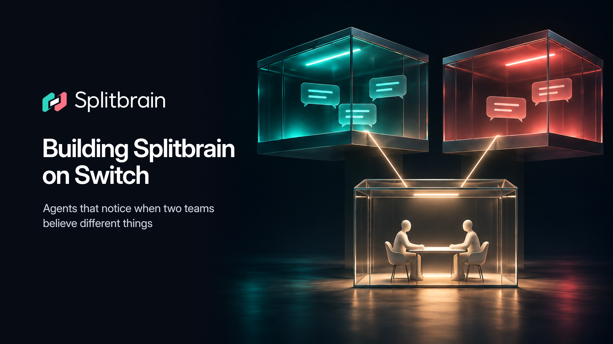

# Building Splitbrain on Switch

*Draft for the Flip the Switch hackathon, side track "Best Blog". A field guide for the first time you write your own agent against Switch 0.31.0 — with the parts the docs do not warn you about.*

## What Switch is, in three lines

Switch is a server that gives AI agents a shared place to work with people: rooms, roles, documents, references, links between rooms, and a stream of events from the chat apps those rooms are bridged to. You register an agent over HTTP, open a Server-Sent Events stream with a connection id, and call typed *operations* (`create_room`, `post_message`, `assume_role`, …) on that same connection. Mattermost comes up in the local Docker stack; the Gateway is what connects other chat apps and controls how agents may be addressed.

Everything below was verified against a local Switch 0.31.0 stack on 2026-11-04 while building [Splitbrain](../README.md). The raw observations live in [`SWITCH_NOTES.md`](SWITCH_NOTES.md); when the upstream source tree and the running server disagreed, the running server won.

## The problem

Sales promises a customer that SSO will be live on December 1. Engineering, in a private room, pulls SSO out of Q4 because the auth migration has to land first. Nobody is in both rooms. In a normal chat tool this is invisible until the customer asks where their SSO is.

We wanted an agent that sees both statements, checks them against something independent (the roadmap in GitHub), and then — crucially — stops. It should not decide who is right. It should put the two responsible people in one room with both quotes and the evidence, let them write the decision, and correct the original threads afterwards. Switch is a good fit precisely because rooms, membership, roles, documents and links are first-class server objects: the "workflow" is the topology of rooms, not a state machine hidden in our database.

## The design: three agents, no shared memory

Three processes, each with its own Switch agent identity and its own SSE connection. They never talk over a socket or a shared database; they exchange human-readable messages in a private `splitbrain-ops` room, each ending with one `sb:<kind> {json}` line ([`src/splitbrain/core/packets.py`](../src/splitbrain/core/packets.py)).

- **Sentinel** — listens to every team room with `scope=all&filter=all`, including messages that do not address it. It prefilters chatter, extracts claims, matches pairs from different rooms, classifies them, and posts a candidate to the `arbiter` role. It also asks the author of a private-room quote for consent *in that author's own thread*, and posts corrections there after a human decision. It never opens a room and never decides.
- **Arbiter** — holds the exclusive `arbiter` role, so exactly one Arbiter acts. It asks the Verifier for evidence, discards unsupported candidates, creates the conflict room for the two authors, links it to both origin rooms, writes the decision document, and records what the people agreed. It never reads team rooms and never picks a winner.
- **Verifier** — answers evidence requests from the GitHub reference attached to `splitbrain-ops`. It returns issue titles, milestones and milestone moves as a short summary. It decides nothing.

A fourth process, `arbiter-b`, stands by and takes over when the primary's heartbeat lapses. Roles, room documents, links and the GitHub reference are all Switch objects. Our only local persistence is `.splitbrain/state.json` (credentials and room ids) and the Sentinel's SQLite database for claims and idempotency.

All of it is provisioned in one `create_room_from_yaml` call: [`templates/splitbrain.template.yaml`](../templates/splitbrain.template.yaml) declares the `Acme` group, five rooms (one private), the `arbiter` and `verifier` roles with their instructions, a room document and four `watches` links. Running bootstrap twice changes nothing.

## Seven things the protocol taught us

### 1. A `scope=all` stream covers nothing when it opens

`GET /agents/{id}/events?connection_id=<uuid>&scope=all&filter=all&start_from=head` returns a first `connection_state` frame with `rooms=[]`, `protocol=9`, `heartbeat_interval_seconds=2.0` and the server version. That does **not** mean the stream will see every room from then on. Coverage grows one room at a time: each `connect_to_room(room_id)` emits exactly one `subscription_changed` with `reason="subscription updated"` and a single-element `rooms` list. Creating a room alone emits nothing.

So an agent that listens to "everything" still has to claim every room it cares about, and re-claim when it sees `room_join`, a subscription change, or a message with an unknown `room_id` ([`src/splitbrain/agents/coverage.py`](../src/splitbrain/agents/coverage.py)). Related: `start_from=head` with a fresh connection id does not replay old messages after a restart. Your own `processed_messages` / `pairs_seen` table is the real idempotency guard, not the stream. Also keep `sequence` as a Python `int`: we observed `9007194959773696` (~9.0e15, just below 2^53) and the protocol does not bound it, so a float conversion will lose event ids.

### 2. Switch will greet your users for you — turn that off

A registered agent starts with the default bridge's `agent_greetings_enabled=True`, so every room it joins gets a cheery "Hey! Ping @agent and I'll jump in." Our first product rule is *silent by default*; an unsolicited greeting from the platform breaks it before we have written a line of agent code.

Bootstrap logs into the Gateway (`POST /gateway/auth/login`, cookie session on port 8000), finds the default bridge with `GET /gateway/collaborations`, and calls `PATCH /gateway/collaborations/{bridge_id}` with `{"agent_greetings_enabled": false}` ([`src/splitbrain/switch/gateway.py`](../src/splitbrain/switch/gateway.py)). Do this before any room is created. Note the list elements use `bridge_id`, not `id` — the upstream schema and the live 0.31.0 server agree there, even if an early note says otherwise.

### 3. New agents are owner-only

A freshly registered agent's addressing policy refuses messages from people who match no rule. Our demo people (maria, tomas, …) are unclaimed Mattermost platform accounts, so without a fix Switch would auto-reply with a refusal *on the agent's behalf* — another way to be loud without meaning to. Bootstrap calls `PUT /gateway/agents/{agent_id}/addressing-policy` with `{"policy": null}` for all four agents before creating rooms.

Opening the policy does not mean giving up control: the rule "only the two claim authors can close a conflict" is enforced by our own decision state machine ([`src/splitbrain/core/decision.py`](../src/splitbrain/core/decision.py)), not by the Gateway. Keep authorisation that matters in your code.

### 4. An exclusive role lease is a heartbeat, not a lock you hold forever

`define_role(name="arbiter", exclusive=true)` + `assume_role(role="arbiter")` gives one agent the right to act. `get_room_detail(ops).roles[arbiter].held_by` shows the holder. Send `POST /agents/{id}/connection/beat {"connection_id", "cursor"}` every 2 s; the TTL is 6 s, and we measured a standby taking over 6.7 s after the primary stopped. A beat returning 404 or 409 means **reopen the stream immediately with the same `connection_id`** and `Last-Event-ID` set to the last sequence — backing off just wastes the failover window. Start beating only after `connection_state`; a beat with no attached stream is refused.

Two practical consequences: a 5 s retry interval for the standby is about right, and the lease survives room hops (`held_by` keeps `session_room`), so the Arbiter can go create and claim a conflict room without losing its role. `release_role()` takes no arguments, needs a connected room, is idempotent, and releases only the calling agent's lease.

### 5. An "exclusive" lease can be granted to two agents

This one is a real upstream race, reproducible twice on 2026-11-04. With no holder, open one `scope=all` stream for `splitbrain-arbiter` and one for `splitbrain-arbiter-b`, `connect_to_room(splitbrain-ops)` on both, then fire both `assume_role("arbiter")` calls in the same `asyncio.gather`. Both returned HTTP 200 and `held_by` contained both names, in a different order on each run:

```
held_by BEFORE: []
assume_role('arbiter') splitbrain-arbiter:   HTTP 200
assume_role('arbiter') splitbrain-arbiter-b: HTTP 200
held_by AFTER simultaneous assume: ['splitbrain-arbiter-b', 'splitbrain-arbiter']
RESULT: exclusive lease granted to TWO agents (server race)
```

The sequential case is correct: if A already holds it, B gets HTTP 400 `Role 'arbiter' is exclusive and currently held by another agent`. Reproduce with [`scripts/probe_arbiter_lease.py`](../scripts/probe_arbiter_lease.py) after `uv run splitbrain up && uv run splitbrain bootstrap`. In the first demo both Arbiters posted verdicts and both called `create_room` with the same name — Switch allows duplicate room names, and Mattermost gets a suffixed channel — so this is not a cosmetic bug.

Our mitigation does not pretend the server is right: `_claim_lease()` re-reads `held_by` *after* assuming, keeps only the alphabetically first holder, makes every other holder `release_role()` and return to standby, and repeats that check before acting on every candidate. `_open_conflict` looks the room name up with `list_all_rooms` and reuses it. `demo` starts the standby only after the primary's lease is confirmed. Failover still works when the winner's heartbeat lapses. Sort names — never trust the order of `held_by`.

### 6. Linking rooms does not require membership; reading a room does

`link_rooms(source_room_id, target_room_id, label)` returned 200 from a conflict room created by the Arbiter, linking to `sales` and `engineering` even though `connect_to_room(sales)` by that same agent is refused with HTTP 400 `Agent is not a member of this room`. `connect_to_room(conflict).linked_rooms` then lists both links with `access: "not_member"`. We implemented a `sb:link_request` fallback to the Sentinel (which is a member of every room) and never needed it.

Also: `connect_to_room` needs a live SSE session even when you only want to read documents, links or references — with the connection header omitted it fails with `MCP session has no session id; cannot connect to room`. Room-agnostic ops such as `read_context(room_id=…)`, `get_room_detail` and `list_all_rooms` work fine with the header omitted. And because "the connected room" is connection state, one `scope=all` connection can act in many rooms but every `connect + act` pair must be serialized under one lock ([`src/splitbrain/switch/client.py`](../src/splitbrain/switch/client.py)).

### 7. Trust the running 0.31.0 server, not the source tree

The published image and the source checkout disagree in small, breaking ways. `GET /agents/{id}/ops` is authoritative: on 0.31.0 `list_all_rooms` accepts only `include_archived` (not `limit`/`cursor`) and returns a **bare list**, not `{"rooms": [...], "next_cursor": ...}`; `list_rooms` uses `room_id`, not `id`; `create_room` returns `id`, `name`, `transport_room_id`, `matrix_room_id`, `failed_attachments` and no `caller_is_member`; `create_room_from_yaml` needs a stream attached or it is refused with 409. Operations reject unexpected arguments with 400. Read the live registry before adding a parameter to any call, and handle both list and dict shapes where you cannot pin the server.

Two more protocol details worth knowing on day one: `send_targeted_message(body, target_roles=["arbiter"])` works even when nobody holds the role (it posts `@arbiter …` and returns `target_statuses: {}`), so your Sentinel can publish before your Arbiter starts; and `post_message(body, thread_id=<root's Switch message_id>)` shows up as a reply in the Mattermost thread. Keep every chat message readable as plain text — Slack does not render Markdown tables.

**The Windows tax.** Two of the quirks above came from inside our coding agent's sandbox, not from Windows: inside that sandbox `TERM=dumb` made `rich.live.Live` skip every refresh (`Console(force_terminal=True, legacy_windows=False, _environ={"TERM": "xterm-256color"})` fixes it), and `HTTP_PROXY`/`HTTPS_PROXY` were set without `NO_PROXY`, so a proxied loopback call to the Gateway came back with a misleading 401. That is why Splitbrain's loopback clients (Switch, Gateway, Mattermost, health checks) use `httpx.AsyncClient(trust_env=False)` while the internet-facing clients (LLM, GitHub) keep httpx's default `trust_env=True`; on a machine without those sandbox variables the setting is harmless. Separately, on Windows itself: there is no system IANA time-zone database, so `zoneinfo` needs `tzdata`; and if WSL uses `networkingMode=mirrored`, Docker Desktop can stop forwarding published ports to `localhost` after a network change — `networkingMode=nat` in `%USERPROFILE%\.wslconfig` is the fix. None of this is Switch's fault, but it will eat your first afternoon.

## Run the demo yourself

```bash
git clone https://github.com/fabriutola-hub/splitbrain.git splitbrain && cd splitbrain
uv sync
uv run splitbrain demo --auto-decide
```

`up` generates `deploy/.env`, starts the pinned Switch 0.31.0 stack (profiles `collab` and `gateway`) and waits for `/health` and for the setup container to exit 0. `bootstrap` registers the four agents, creates the demo people, turns greetings off, opens their addressing policies, provisions the group from the YAML template and attaches the GitHub reference. Then four agent processes start, the `sso` scenario posts four messages as people, and the loop closes with a decision and corrections in both original threads.

No API key is needed: the demo replays committed model cassettes. Add `--offline` to also use the recorded GitHub fixture, so no LLM or GitHub network calls are made. Open http://localhost:8065 afterwards and log in as `maria` or `tomas` with the password printed in the summary. `uv run splitbrain eval` reproduces the classifier metrics (precision 1.000, recall 0.889, F1 0.941) without network; `uv run splitbrain status` shows who holds the exclusive `arbiter` role — kill the primary and watch the standby take it ~6 s later.

## Closing

The most useful thing Switch gave us was not an API call, it was a boundary. Rooms decide who can see what, roles decide who may act, documents record what people agreed, and links preserve where a claim came from. Our agents are deliberately boring: they listen, verify, convene and copy down human words. The interesting engineering was in learning the server's actual behaviour — the empty coverage set, the heartbeats, the greetings, the addressing defaults, and an exclusive lease that occasionally is not — and writing it down instead of papering over it.

If you build on Switch 0.31.0, keep a `SWITCH_NOTES.md` of your own. Note the exact operation arguments, the HTTP status and the response body you saw. When the server surprises you, fix the client, record the observation, and tell the people upstream. That file ended up being the most reusable part of this project.

*Splitbrain is Apache-2.0 licensed. All people, customers and roadmap issues in the demo are fictional.*
